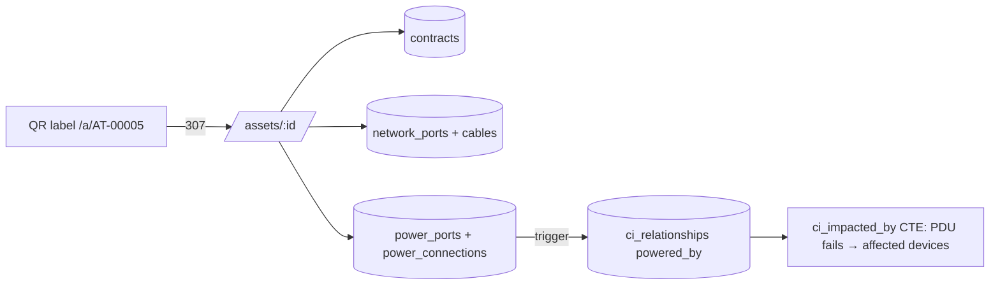

# Architecture

An IT asset, infrastructure and dependency platform in the spirit of Device42: CMDB, DCIM (rack elevations), IPAM, agentless discovery and application dependency mapping.

## System diagram

```mermaid
flowchart LR
  subgraph Client
    B[Browser<br/>desktop + mobile asset view]
  end

  subgraph Web["apps/web · Next.js App Router"]
    SSR[Server components<br/>rack, asset, subnet pages]
    UI[Client components<br/>RackElevation · Topology graph]
  end

  subgraph API["apps/api · NestJS gateway  /api/v1"]
    REST[REST controllers<br/>OpenAPI at /docs]
    WS[WebSocket gateway<br/>discovery job progress]
    AUTH[JWT guard + RBAC<br/>admin · dc_technician · network_engineer · auditor]
    SVC[Domain services<br/>Assets · RackPlacement · IPAM · CMDB graph]
    AUD[AuditService<br/>before/after diff in same tx]
    VAULT[Credential vault<br/>AES-256-GCM, key from KMS/env]
  end

  subgraph Data
    PG[(PostgreSQL 16<br/>inet/cidr · GiST EXCLUDE · JSONB<br/>recursive CTE graph)]
    RD[(Redis<br/>BullMQ queues)]
  end

  subgraph Workers["Discovery & integration workers"]
    DW[Discovery worker · Python<br/>SNMP v1/v2c/v3 · SSH · WinRM · nmap<br/>AWS · Azure · vSphere]
    REC[Reconciler<br/>dedupe by UUID → serial → MAC]
    WH[Webhook dispatcher<br/>Jira SM · ServiceNow · Slack]
  end

  B --> SSR --> REST
  B --> UI --> REST
  UI <-.-> WS
  REST --> AUTH --> SVC
  SVC --> AUD --> PG
  SVC --> PG
  SVC -- enqueue jobs --> RD
  RD --> DW --> REC -- upsert CIs --> REST
  RD --> WH
  DW -. decrypt creds .-> VAULT
  WS <-. job events .- RD
```

## Scope by phase

| Area | Phase 1 | Phase 2 | Later |
|---|---|---|---|
| Gateway | NestJS REST, OpenAPI, JWT RBAC, error mapping | Same, 30+ new routes | GraphQL, WebSocket job stream |
| Data | Core DDL, integrity in the database | Migration `0002`: lifecycle, cabling, power | Neo4j projection for very large graphs |
| Assets | CRUD, U-space collision (app pre-check + DB `EXCLUDE`) | Vendors, POs, contracts, depreciation, maintenance, components, tag/serial lookup | Bulk import, custom-field schemas |
| IPAM | Subnet create/tree/utilisation, allocate/reserve/release | Port MAC lookup (groundwork for CAM mapping) | DNS, DHCP scopes, ARP/CAM ingestion |
| DCIM | Interactive 42U elevation, front/rear, drag-to-move | Ports, cables, patch-panel pass-through, path trace, PDU outlets, rack power budget | Live power telemetry (SNMP), floor plans |
| UI | Rack elevation | Mobile asset page, QR label sheet, contract expiry and coverage gaps, rack power panel | Dependency map |
| Discovery | Tables only | | Workers, scheduler, vault, reconciliation |

### Phase 2 flows



- **Path trace** walks cable → far port → pass-through partner → cable, up to 64 hops, and reports why it stopped (`endpoint`, `uncabled`, `loop`, `max_hops`).
- **Power budget**: a device's draw is split evenly across its connected inlets (A/B supplies share load) and summed per PDU. A device with two or more PSUs on fewer than two feeds is flagged `singleFed`. A consumer with draw or inlets but no cord is flagged `unpowered`.
- **Depreciation**: straight-line, or double-declining switching to straight-line once that is larger, on month granularity from the in-service date. Never below salvage value.

## Integrity rules enforced by PostgreSQL

Every rule below holds even if a client bypasses the API:

- **Rack U-space:** `asset_rack_occupancy` has `EXCLUDE USING gist (rack_id WITH =, face WITH =, u_range WITH &&)`. Full-depth devices occupy both faces, half-depth devices one face, zero-U devices none. A trigger keeps the table in sync with `assets` and rejects devices that run past the top of the rack.
- **Subnets:** CIDR is normalised (host bits rejected), duplicates are blocked per VRF, and the parent is resolved automatically as the smallest containing subnet. Children are re-parented when a supernet is inserted.
- **IPs:** must sit inside their subnet, cannot be the network or broadcast address (IPv4 /0–/30), and are unique per VRF.
- **Audit:** `audit_logs` is append-only; UPDATE and DELETE raise.
- **Patch panels (KB011):** a pass-through pairs a `patch_front` with a `patch_rear` port on the same asset; pairing is mirrored automatically and each port pairs once.
- **Power (KB010):** a cord runs outlet → inlet, between different assets, at the same voltage. Each outlet and inlet carries one cord (unique). Plugging in creates a `powered_by` CMDB edge; unplugging the last cord between two assets removes it.
- **Cabling:** each port carries at most one cable (unique on both endpoints); the API also locks both ports `FOR UPDATE` to return a clear `PORT_IN_USE`.
- **Lifecycle:** contract `end_date >= start_date`; contract numbers unique per vendor; vendor names unique case-insensitively; salvage ≤ cost and in-service ≥ purchase date (CHECK); maintenance `next_due_on` is a generated column.

The API also pre-checks rack placement and CIDR validity so it can return friendly 409/422 bodies. The constraints are the race-proof backstop.
